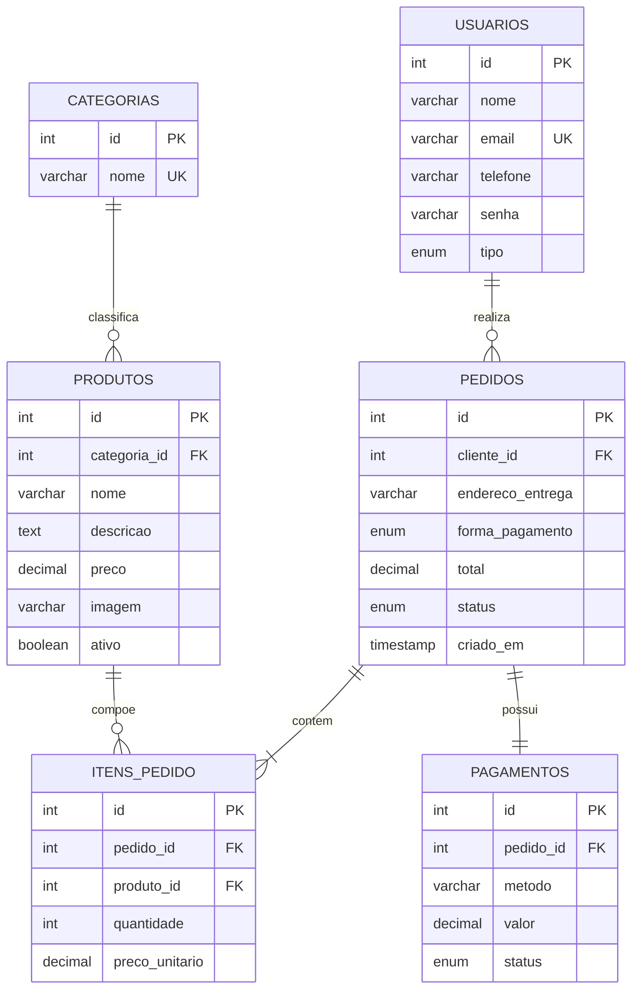
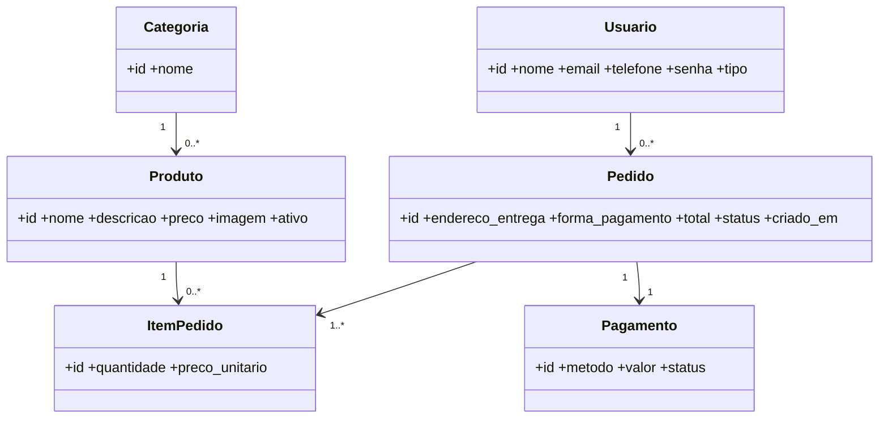
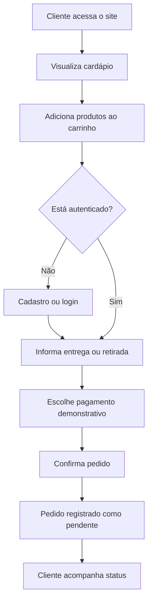

# Projeto Integrador Transdisciplinar em Sistemas de Informação II
## Café & Afeto — Sistema web para cafeteria com pedidos online

**Aluna:** Bárbara Silva de Macedo  
**Curso:** Sistemas de Informação  
**Instituição:** Cruzeiro do Sul Virtual  
**Disciplina:** Projeto Integrador Transdisciplinar em Sistemas de Informação II  
**Ano:** 2026

> Documento de desenvolvimento do PIT II. Os campos de polo, tutor, turma e data devem ser completados conforme as informações do AVA. O arquivo do PIT I não está disponível para consulta; por isso, este documento descreve o escopo e as decisões técnicas que podem ser comprovados nesta versão, sem atribuir ao trabalho anterior informações que não foram recuperadas.

## 1. Resumo
O projeto consiste no desenvolvimento de uma aplicação web para apoiar o atendimento de uma cafeteria gourmet. O sistema disponibiliza um cardápio digital, cadastro e autenticação de clientes, carrinho de compras, registro de pedidos, escolha de forma de pagamento demonstrativa e acompanhamento do status. Também possui área administrativa para gerenciamento de produtos e acompanhamento dos pedidos. A solução utiliza PHP, MySQL, HTML, CSS e JavaScript, organizada em uma estrutura inspirada no padrão MVC e executada localmente por meio do XAMPP.

**Palavras-chave:** cafeteria; sistema web; PHP; MySQL; MVC; pedidos online.

## 2. Introdução e contextualização
Pequenos estabelecimentos de alimentação precisam organizar informações de produtos, clientes e pedidos. Quando essas atividades são feitas manualmente, podem ocorrer falhas de comunicação, demora no atendimento e dificuldade para acompanhar o andamento das solicitações. Um sistema web simples pode centralizar essas informações e oferecer ao cliente uma forma prática de consultar o cardápio e registrar pedidos.

Para esta versão, foi escolhido o cenário de uma cafeteria chamada Café & Afeto, com atendimento por pedidos online. A aplicação reúne banco de dados relacional, interface web e processamento no servidor. Como o material do PIT I não está disponível, não é possível comparar este escopo com as decisões registradas naquela etapa.

### Observação sobre a etapa anterior
O documento e os arquivos do PIT I não foram disponibilizados para esta revisão. Assim, a descrição apresentada aqui registra a solução implementada no PIT II. Caso o AVA exija comparação literal com o PIT I, será necessário recuperar essa versão com a instituição ou com a tutoria.

## 3. Problema
Como uma aplicação web de baixo custo pode organizar o cardápio, o cadastro de clientes e o fluxo de pedidos de uma cafeteria, oferecendo ao mesmo tempo uma interface simples para o consumidor e ferramentas básicas de administração?

## 4. Justificativa
A informatização do fluxo de pedidos pode reduzir retrabalho, padronizar o registro das compras e facilitar a consulta de informações. O projeto também permite aplicar, de forma integrada, conhecimentos de modelagem de dados, programação web, arquitetura MVC, interface humano-computador e testes de software.

## 5. Objetivos
### 5.1 Objetivo geral
Desenvolver uma aplicação web para gerenciamento básico de uma cafeteria gourmet, permitindo que clientes consultem produtos e registrem pedidos e que um administrador mantenha o cardápio e atualize o andamento das solicitações.

### 5.2 Objetivos específicos
- Modelar os dados e seus relacionamentos.
- Implementar banco de dados relacional em MySQL.
- Criar interface responsiva com HTML, CSS e JavaScript.
- Implementar cadastro, login e controle de acesso.
- Implementar cardápio, carrinho e finalização de pedidos.
- Criar painel administrativo para produtos e pedidos.
- Realizar testes funcionais e coletar avaliações de cinco usuários.
- Registrar problemas encontrados, correções e melhorias.

## 6. Escopo e limites
### Incluído
- Cadastro e autenticação de clientes.
- Listagem de produtos ativos por categoria.
- Carrinho com alteração de quantidades.
- Registro de pedido com endereço ou retirada no balcão.
- Seleção de PIX, cartão na entrega ou dinheiro na entrega em modo demonstrativo.
- Consulta dos pedidos do cliente.
- Administração de produtos e status de pedidos.
- Indicadores simples de quantidade de pedidos e vendas concluídas.

### Não incluído nesta versão
- Integração real com banco, gateway de pagamento ou PIX.
- Emissão fiscal, controle de estoque, cálculo automático de frete ou integração com entregadores.
- Aplicativo nativo para celular e hospedagem pública.

## 7. Requisitos funcionais
| Código | Requisito |
|---|---|
| RF01 | O sistema deve permitir cadastro de cliente com nome, e-mail, telefone e senha. |
| RF02 | O sistema deve autenticar o cliente por e-mail e senha. |
| RF03 | O sistema deve exibir produtos ativos e suas categorias, descrições e preços. |
| RF04 | O cliente deve adicionar produtos ao carrinho. |
| RF05 | O cliente deve alterar quantidades ou remover itens do carrinho. |
| RF06 | O cliente autenticado deve finalizar pedido informando endereço ou retirada. |
| RF07 | O cliente deve selecionar uma forma de pagamento demonstrativa. |
| RF08 | O sistema deve registrar pedido, itens e pagamento pendente. |
| RF09 | O cliente deve consultar seus pedidos e respectivos status. |
| RF10 | O administrador deve cadastrar e excluir produtos. |
| RF11 | O administrador deve consultar pedidos e atualizar seus status. |
| RF12 | O painel deve exibir total de pedidos e vendas de pedidos concluídos. |

## 8. Requisitos não funcionais
- RNF01: aplicação web compatível com navegadores atuais.
- RNF02: interface responsiva para desktop e celular.
- RNF03: senhas armazenadas com hash por `password_hash`.
- RNF04: consultas ao banco realizadas com PDO e prepared statements.
- RNF05: dados armazenados em MySQL com relacionamentos e integridade referencial.
- RNF06: mensagens de retorno devem informar sucesso ou falha das operações.
- RNF07: a aplicação deve ser executável localmente em ambiente XAMPP.
- RNF08: o código deve estar organizado em controladores, modelos e visualizações.

## 9. Tecnologias e arquitetura
- **Front-end:** HTML5, CSS3 e JavaScript nativo (usado na confirmação de ações administrativas).
- **Back-end:** PHP 8 ou superior.
- **Banco de dados:** MySQL/MariaDB.
- **Ambiente local:** XAMPP.
- **Acesso a dados:** PDO.
- **Arquitetura:** separação inspirada em MVC. `models` concentram acesso a dados; `views` apresentam as telas; `controllers` recebem ações e coordenam o fluxo; `index.php` realiza o roteamento.

### 9.1 Organização das pastas
```text
cafeteria_pit2/
├── app/
│   ├── controllers/
│   ├── models/
│   └── views/
├── config/
├── database/
├── docs/
├── public/assets/
├── tests/
├── index.php
└── README.txt
```

## 10. Modelagem de dados
### 10.1 Entidades
- **Usuário:** identifica clientes e administradores; contém nome, e-mail, telefone, senha e tipo de acesso.
- **Categoria:** classifica os produtos do cardápio.
- **Produto:** representa um item vendido pela cafeteria, com categoria, nome, descrição, preço, imagem e situação ativa.
- **Pedido:** registra a compra feita por um cliente, endereço/retirada, forma de pagamento, total, status e data.
- **Item do pedido:** registra cada produto, quantidade e preço unitário no momento da compra.
- **Pagamento:** registra método, valor e estado demonstrativo do pagamento.

### 10.2 Relacionamentos e cardinalidades
- Um usuário pode realizar zero ou muitos pedidos (1:N).
- Uma categoria pode agrupar zero ou muitos produtos (1:N).
- Um pedido possui um ou muitos itens (1:N).
- Um produto pode aparecer em muitos itens de pedidos (1:N).
- Um pedido possui um registro de pagamento nesta versão (1:1 lógico).

### 10.3 Diagrama ER (Mermaid)


### 10.4 Diagrama de classes simplificado


## 11. Casos de uso
**Ator Cliente:** cadastrar-se, entrar, visualizar cardápio, adicionar/remover itens, finalizar pedido e consultar pedidos.  
**Ator Administrador:** entrar, cadastrar/excluir produto, consultar pedidos e alterar status.



## 12. Regras de negócio
- RN01: somente produtos ativos aparecem no cardápio.
- RN02: o cliente precisa estar autenticado para finalizar pedido.
- RN03: a quantidade de cada produto deve ser positiva; zero remove o item.
- RN04: o total do pedido corresponde à soma de quantidade multiplicada pelo preço unitário de cada item.
- RN05: o pedido inicia com status “Pendente”.
- RN06: o pagamento inicia como “Aguardando”, pois a integração é simulada.
- RN07: apenas usuário do tipo administrador acessa o painel administrativo.
- RN08: status permitidos: Pendente, Preparando, Pronto, Concluído e Cancelado.

## 13. Interface e experiência do usuário
A interface utiliza tons terrosos, fundo claro e elementos visuais associados a uma cafeteria. A navegação principal apresenta cardápio, carrinho, autenticação, pedidos e administração (quando autorizado). Os formulários possuem rótulos claros e mensagens de retorno. O layout se adapta a telas menores.

## 14. Implementação e banco físico
O script `database/cafeteria_pit2.sql` cria o banco, tabelas, chaves primárias e estrangeiras e inclui produtos iniciais para demonstração. A conexão é realizada por PDO, configurada em `config/config.php`. O roteiro de instalação está em `README.txt`. As operações que alteram dados são enviadas por formulários POST e verificadas por token CSRF.

## 15. Plano de testes (verificação e validação)
Os testes devem ser executados após instalação local. Registrar resultado real, evidência (captura de tela), data, observação e correção quando aplicável.

| ID | Cenário | Resultado esperado |
|---|---|---|
| T01 | Cadastrar cliente com dados válidos | Conta criada e mensagem de confirmação |
| T02 | Cadastrar e-mail já utilizado | Cadastro recusado com aviso |
| T03 | Login com senha correta | Usuário autenticado |
| T04 | Login com senha incorreta | Acesso negado e mensagem |
| T05 | Adicionar produto ao carrinho | Produto e quantidade exibidos |
| T06 | Alterar quantidade para 2 | Subtotal e total recalculados |
| T07 | Remover item com quantidade zero | Item removido |
| T08 | Finalizar sem login | Redirecionamento para login |
| T09 | Finalizar pedido com dados válidos | Pedido, itens e pagamento pendente gravados |
| T10 | Consultar meus pedidos | Apenas pedidos do cliente logado aparecem |
| T11 | Acessar administração como cliente | Acesso bloqueado |
| T12 | Administrador cadastrar produto | Produto salvo e exibido no cardápio |
| T13 | Administrador atualizar status | Novo status armazenado e exibido |
| T14 | Abrir site em celular | Conteúdo reorganizado sem perda das funções principais |

## 16. Avaliação com cinco usuários
A atividade requer cinco colegas testando a solução. Cada participante deve executar tarefas do roteiro, registrar o que funcionou, o que falhou e o que não conseguiu testar. Os formulários individuais estão em `tests/`. Não preencher resultados fictícios. Após receber as avaliações, consolidar as observações, corrigir o que for pertinente e anexar evidências das versões antes/depois.

## 17. Laudo de qualidade — modelo para preencher após os testes
**Sistema:** Café & Afeto  
**Versão testada:** ______  
**Data:** ______  
**Responsável:** ______  
**Quantidade de participantes:** ______ (meta: 5)

| Item avaliado | Evidência | Resultado | Correção/ação |
|---|---|---|---|
| Cadastro e login | Anexar captura | A preencher | A preencher |
| Cardápio e carrinho | Anexar captura | A preencher | A preencher |
| Finalização de pedido | Anexar captura | A preencher | A preencher |
| Consulta de pedidos | Anexar captura | A preencher | A preencher |
| Painel administrativo | Anexar captura | A preencher | A preencher |

**Conclusão do laudo:** preencher somente depois da execução dos testes, informando limitações, defeitos encontrados, correções aplicadas e pendências conhecidas.

## 18. Manual resumido de utilização
### Cliente
1. Acesse a página inicial e consulte o cardápio.
2. Clique em “Adicionar” nos produtos desejados.
3. Abra o carrinho e ajuste as quantidades.
4. Faça cadastro ou login para finalizar.
5. Informe endereço ou retirada no balcão e escolha a forma de pagamento demonstrativa.
6. Confirme e consulte “Meus pedidos” para acompanhar o status.

### Administrador
1. Entre com uma conta do tipo administrador.
2. Acesse “Administração”.
3. Cadastre produtos preenchendo nome, categoria, preço e descrição.
4. Consulte os pedidos e atualize o status conforme o fluxo de atendimento.

## 19. Roteiro do vídeo demonstrativo (até 5 minutos)
- **0:00–0:30:** apresentar o objetivo do Café & Afeto e as tecnologias utilizadas.
- **0:30–1:15:** mostrar a página inicial e o cardápio.
- **1:15–2:00:** demonstrar cadastro/login e inclusão de produtos no carrinho.
- **2:00–2:45:** finalizar pedido, explicar que pagamento é simulado e mostrar “Meus pedidos”.
- **2:45–3:45:** entrar como administrador, cadastrar produto e atualizar status de pedido.
- **3:45–4:30:** mostrar banco de dados e estrutura MVC.
- **4:30–5:00:** comentar testes realizados, melhorias feitas e conclusão.

## 20. Considerações finais
A solução implementa o fluxo essencial de uma cafeteria com pedidos online em ambiente local. O desenvolvimento integra interface, processamento no servidor e persistência em banco de dados. A etapa de avaliação por cinco usuários ainda precisa ser executada. Os resultados não foram preenchidos porque dependem da participação real dos colegas. Como evolução futura, podem ser consideradas integração real de pagamentos, controle de estoque, cálculo de entrega e hospedagem segura.

## 21. Referências
- CRUZEIRO DO SUL VIRTUAL. *Projeto Integrador Transdisciplinar em Sistemas de Informação II — Material didático*. Conteudista: Prof. Me. Artur Marques. Material fornecido no AVA, 2026.
- PHP. *PHP Manual*. Disponível em: https://www.php.net/manual/pt_BR/ . Acesso em: 1 nov. 2026.
- MYSQL. *MySQL 8.0 Reference Manual*. Disponível em: https://dev.mysql.com/doc/ . Acesso em: 1 nov. 2026.
- USABILITY.GOV. *User Interface Design Basics*. 2022. Referência indicada no material didático do PIT II.
